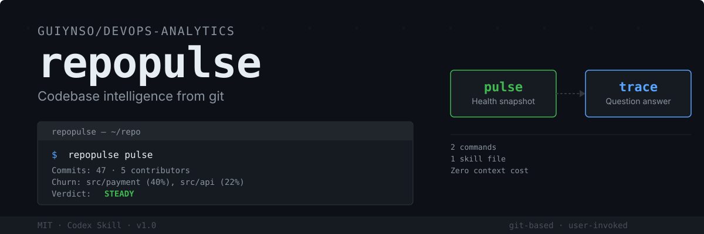

<p align="center">
  
</p>

---

## What is repopulse

RepoPulse is a user-invoked Codex skill for understanding unfamiliar Git repositories.

## Quick start

Git is required; GitHub CLI is optional for pull-request context.

### Install

Windows PowerShell:

```powershell
$skillsDir = if ($env:CODEX_HOME) { Join-Path $env:CODEX_HOME "skills" } else { Join-Path $HOME ".codex\skills" }
New-Item -ItemType Directory -Force $skillsDir | Out-Null
Copy-Item -Path ".\skills\repopulse" -Destination $skillsDir -Recurse -Force
```

macOS / Linux:

```bash
mkdir -p "${CODEX_HOME:-$HOME/.codex}/skills"
cp -R skills/repopulse "${CODEX_HOME:-$HOME/.codex}/skills/repopulse"
```

### Try it

Run `repopulse pulse` for a health snapshot, or `repopulse trace "..."` to investigate a question through Git history in a Codex session pointed at a Git repository.

---

## From EIA to repopulse

The previous version was a six-skill pipeline with JSON contracts and bilingual rules. **repopulse** cuts the surface area to a fraction while keeping the core insight: git holds the answers.

| | EIA (old) | repopulse |
|---|---|---|
| **Files** | 6 skills, pipeline orchestration | 1 `SKILL.md` + 1 reference file |
| **Context cost** | Always loaded (model-invoked) | Zero cost (user-invoked) |
| **Data** | git + GitHub + external APIs | git first, `gh` when available |
| **Output** | JSON schemas per step | Natural language |
| **Size** | ~30 KB | ~4.7 KB |

---

## Two branches

### Pulse

A quick health snapshot. Three steps:

1. **Read the shape** — `git log` for commit cadence, contributor distribution, and file churn.
2. **Read the open work** — `gh pr list` for in-flight pull requests.
3. **Synthesise a verdict** — **steady**, **frayed**, or **hot**, with supporting evidence.

Use pulse before any unfamiliar repository. It answers: _is this repo healthy, and where should I look next?_

Completion criterion: a pulse verdict is written.

### Trace

Follow a question backward through the commit graph. Given a file, a time window, a PR number, or a symptom, it runs 2–4 git commands and reports the causal chain.

| When you ask about | It starts with |
|---|---|
| A file or module | `git log --since="90 days ago" -- <path>` |
| A bug or regression | `git log --all --oneline --grep="fix" --since="90 days ago"` |
| Who changed what | `git shortlog -sn --since="90 days ago" -- <path>` |
| A time window | `git log --after / --before` with `--format` |
| A PR | `gh pr view <number> --json commits,files,reviews` |

Completion criterion: the question is answered with evidence, or an explicit data gap is stated.

---

## Implementation

```
skills/repopulse/
├── SKILL.md         — Core behaviour (user-invoked, 2 branches, completion criteria)
└── commands.md      — External reference (exact git flag combinations)
```

### Design decisions

**User-invoked.** `disable-model-invocation: true` removes the description from the agent's context. The skill costs nothing until called by name.

**Leading word "pulse".** The model already understands _pulse_ as a quick check — its pretrained meaning costs no tokens to install. The verdicts (steady / frayed / hot) extend the metaphor naturally.

**Progressive disclosure.** Basic git commands are inlined in `SKILL.md`. Exact flag combinations with edge cases live in `commands.md`, loaded only when the agent needs them.

**Single pass per call.** The skill runs exactly one branch. No orchestration, no pipeline state, no JSON handoff.

---

## Development

**License:** MIT

To modify:

1. Edit `skills/repopulse/SKILL.md`.
2. Run the skill against a test repository.
3. If behaviour diverges from the completion criteria, sharpen the wording or move edge-case commands to `commands.md`.

